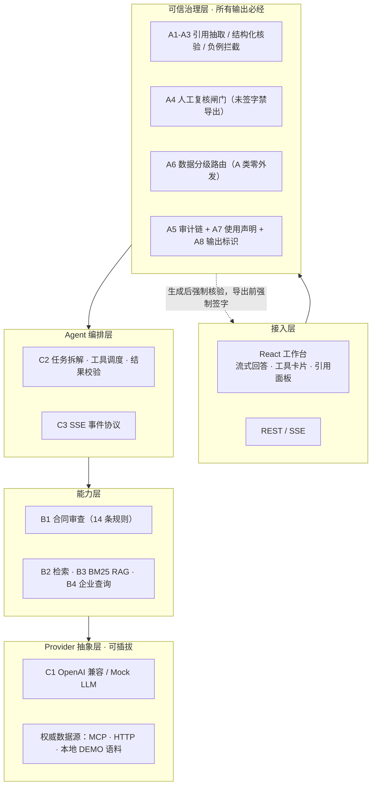

# LexGuard · 可溯源的法律智能体平台

> **Compliance-first, self-hostable legal agent platform with citation verification and audit trails.**
>
> 面向中国法域的「合规优先」法律智能体平台：开源、可自托管、可插拔权威数据源。
> 把**引用核验、人工复核、数据分级、审计留痕**做成 Agent 工作流的强制必经节点，
> 让每条输出都能回答：依据在哪、谁复核过、数据去了哪。

**AI 辅助生成，仅供参考，不构成法律意见。** 本仓库是工程参考实现，作者不对外提供法律服务；部署方须自行判断备案、等保与数据合规义务。

---

## 为什么做这个

法律 AI 在 2026 年不缺「能回答」的产品，缺的是「敢签字」的输出：

| 数据 | 含义 | 来源 |
|---|---|---|
| **45%** | 中国内地法律人把「审核不可靠 AI 输出所需时间」列为主要顾虑 | LexisNexis《2026 中国内地法律人工智能认知与态度调查报告》，n=411 |
| **77%** | 若 AI 融入引导式工作流，会提高日常使用意愿 | 同上 |
| **11%** | 达到「连接式 / 全工作流」成熟度的团队占比 | LegalOn 2026 |

同时，2026 年新出的监管要求已经把「可信」变成硬性工程需求：

- 《法律服务领域大模型部署应用指引》（2026-07-18，上海，全国首部）：AI 仅作辅助工具、公众内容标识、关键环节强制人工复核留痕、审计日志留存不少于 3 年、敏感数据不出域、绑定权威法条库。
- 地方律协执业指引：对外文书须承办律师逐条实质审核签字；**AI 生成的法条、判例须通过官方数据库调取全文比对，不得以检索摘要作为核验依据**。
- 法院风险提示：提交诉讼文书须如实填写《人工智能使用声明》，逐项核验法条与案例，禁止未核验内容作为诉讼主张。

**这些条款目前几乎没有对应的开源参考实现**——这就是本项目的位置。GitHub `legal-ai` topic 已有 860+ 仓库，但绝大多数是检索 / 审查 / 聊天工具；再做第 101 个「Harvey 平替」没有意义。

---

## 快速开始（无需任何密钥）

```bash
npm install
npm run dev        # 后端 http://localhost:3001，前端 http://localhost:5173
```

`LLM_API_KEY` 为空时自动切换内置 **Mock LLM**，配合本地演示语料，**断网也能完整演示**：
发起对话 → 工具调用 → 生成带引用的回答 → 引用逐条核验 → 逐条签字 → 导出四件套 → 查看审计日志。

其他命令：

```bash
npm run typecheck   # tsc --noEmit
npm run test        # vitest run
npm run build       # typecheck + vite build
npm run check       # 以上全部
npm start           # 仅启动后端（生产模式，托管 dist/）
npm run mcp         # 启动 MCP Server（stdio，供 Claude / WorkBuddy 等宿主接入）
```

### 接真实模型

```bash
cp .env.example .env
# 编辑 .env，填入任意 OpenAI 兼容服务
```

```dotenv
LLM_BASE_URL=https://api.deepseek.com/v1
LLM_MODEL=deepseek-chat
LLM_API_KEY=sk-xxxxx
```

兼容 DeepSeek / 通义 / OpenAI / 本地 Ollama。`.env` 已被 `.gitignore` 排除，**密钥绝不入库**。

### 接权威法律数据源

```dotenv
LAW_DATASOURCE=http
LAW_DATASOURCE_URL=https://your-mcp-gateway.example.com
LAW_DATASOURCE_TOKEN=...
```

`HttpLawDataSource` 定义了 REST 契约，可由北大法宝 MCP、企查查 MCP 等已授权服务适配。
**本平台不复制、不缓存权威库全文**，只存标识、出处链接与时效元数据。

---

## 运行架构



**关键设计：治理层是必经节点，不是「生成后补个脚注」。** 任何回答、任何导出、任何外部模型调用都必须穿过它。

---

## 核心机制：引用核验引擎

```
模型输出文本
  → A1 抽取：法名 / 条号 / 款项 / 案号 / 企业主体（含中文数字与别名归一、残缺引用显式捕获）
  → A2 结构化查库：按「法名 + 条号」精确命中，绝不交给模型或向量检索裁决
  → 六态标注：verified / repealed / not_in_corpus / demo_only / malformed / needs_human
  → 附带：效力级别、时效性、修订沿革、权威原文链接
  → A4 进入逐条人工复核队列
```

> ⭐ **技术红线：语义相似 ≠ 法条命中。** 存在性、条号与时效必须结构化查库；
> 模型只负责语义组织，绝不裁决「这条法条存不存在」。
> 核验结果缺权威原文链接时判 `needs_human`——律协明确要求不得以检索摘要作为核验依据。

**六类幻觉负例均有独立测试**：编造条号、已废止法条（如《合同法》第 52 条）、虚构案号、
演示案号 / 张冠李戴、款项定位、格式异常。

---

## 合规映射（监管条款 → 产品能力 → 可验收检查点）

| 规范要求 | 产品能力 | 工程检查点 |
|---|---|---|
| AI 仅为辅助工具，不得替代专业判断 | 输出状态机止于 `pending_review` | 无复核签字时 `/api/export/:id` 返回 **403** |
| 面向公众内容标识 AI 生成 | `DISCLAIMER` 常量 | 前端横幅 + 每份导出物开头双处校验 |
| 关键环节「AI 生成 + 人工复核」，强制留痕 | `ReviewGate` 逐条确认 | 单测覆盖「跳过复核 → 拒绝导出」 |
| 引用回权威库全文比对，不得杜撰 | `verifyCitations` + 权威源 Provider | 六类负例测试全部检出 |
| 审计日志留存不少于 3 年 | `AuditLog` append-only + JSONL | `/api/audit` 可导出报告 |
| 敏感数据不出域 | A/B/C 用途路由 + 越级拦截 | A 类请求不产生任何外部 fetch，CI 有断言 |
| 《人工智能使用声明》 | `buildAiUsageDeclaration` | 导出四件套随附声明与逐项核验清单 |

---

## 演示数据纪律（F2）

一个主打防幻觉的项目，自带伪造案号即自毁。因此：

- 法条**只存编号 + 效力状态 + 条文主旨摘要**，绝不冒充官方全文；
- 案号统一 `DEMO-CASE-YYYY-NNN`，**绝不伪造真实裁判文书案号**；
- 企业名称带「（演示）」、信用代码用 `DEMO-` 前缀；
- 全部记录 `demo: true`，核验引擎据此返回 `demo_only`，**绝不把演示语料伪装成权威核验通过**；
- 接权威库并带 `sourceUrl` 后，正例才会变为 `verified`。

---

## 评测（B5）

`server/eval/dataset.ts` 提供固定评测集（正例 + 六类负例，固定顺序、不随机），
`tests/citations.test.ts` 验证状态判定逻辑。

| 指标 | 定义 | 公式 | 边界 | 局限 |
|---|---|---|---|---|
| `accuracy` | 状态判对率 | 判对数 / 样本数 | 每样本只取主状态 | 构造负例 ≠ 真实幻觉分布 |
| `precision` | 按状态分类的精确率 | TP / (TP+FP) | 分母 0 记 0 | 演示语料 ≠ 权威库 |
| `recall` | 按状态分类的召回率 | TP / (TP+FN) | 分母 0 记 0 | 只反映引擎逻辑 |

> ⚠️ **本项目不发布任何「法律问答准确率」或「幻觉率」数字。** 未建权威库标注集前，
> 上述指标只能说明「核验引擎的状态判定逻辑正确」，不能说明法域覆盖能力。
> 法律专用 RAG 工具公开实测仍有 17%–34% 幻觉率，本平台**不宣称零幻觉**。

---

## 已实现（4 期 29 项全部落地）

分期规划见 [ROADMAP.md](./ROADMAP.md)。

| 期 | 状态 | 内容 |
|---|---|---|
| 第 1 期 · 可信内核（13 项） | ✅ | A1–A8、B1、B5、F1–F3 |
| 第 2 期 · Agent 与工作台（9 项） | ✅ | B2–B4、C1–C3、D1–D3 |
| 第 3 期 · 平台化（6 项） | ✅ | C4 Skill 中心、C5 事实层、D4 MCP Server、E1 多租户、E2 数据源管理、E3 用量成本 |
| 第 4 期 · 开源发布（F4） | ✅ | README、LICENSE、CI、合规映射表、公开仓库 |

**验证**：51 个单测 / 8 个测试文件、typecheck、build、端到端（未签字 403 → 签字 200 四件套）、MCP stdio 实跑、GitHub Actions CI 全绿。

### 第 3 期能力说明

- **C4 Skill 中心**：三份版本化清单（合同审查 / 法律意见书 / 并购尽调）；同名同版本禁止覆盖，必填项逐项确认后才能完成，支持导入导出。
- **C5 案件事实层**：每条事实强制带出处；矛盾显式挂起（不自动合并、不投票、不让模型裁决），并显式列出「应存在但缺失」的事实。
- **D4 MCP Server**：零依赖 stdio JSON-RPC，暴露 6 个法律工具；`npm run mcp` 启动，配置见 `.mcp.example.json`。
- **E1 多租户与伦理墙**：角色权限矩阵 + 项目级名单；被排除项目根本不出现在列表里。中文用户名走 query 参数（HTTP header 有 ByteString 限制）。
- **E2 数据源管理**：健康检查 + 失败降级；降级后 `demo` 变 true，核验结果自动变为 `demo_only`，绝不伪装成权威核验通过。
- **E3 用量与成本**：按会话记录 token 估算与工具调用；token 为字符数 / 4 的粗略估算，**非厂商计费口径**。

### API 一览

| 方法 | 路径 | 说明 |
|---|---|---|
| GET | `/api/health` | 当前 LLM、数据源、规则数与审计事件数 |
| POST | `/api/chat` | SSE 事件流：`delta / tool_call / tool_result / verification / review_required / done / error` |
| POST | `/api/contract/review` | 合同审查，返回风险清单与依据引用核验 |
| POST | `/api/verify` | 单独核验一段文本中的法条 / 案号引用 |
| POST | `/api/review` | 逐条人工复核签字 |
| GET | `/api/review/:sessionId` | 复核进度与待签项 |
| GET | `/api/export/:sessionId` | 导出四件套（未签字 / 含阻断引用 → 403） |
| GET | `/api/audit` | 审计事件与可读报告 |
| GET | `/api/platform` | 平台汇总：Skill / 事实 / 矛盾 / 缺口 / 用量 / 数据源 / 权限 / MCP 工具 |
| POST | `/api/skills/check` | 逐项校验 Skill 清单 |
| POST | `/api/facts` | 写入事实（无出处 → 400） |
| GET | `/api/usage` | 用量汇总与最近记录 |
| POST | `/api/datasources/health` | 数据源健康检查与降级 |
| GET | `/api/tenants/:id/matters?userId=` | 按伦理墙过滤后的可见项目 |
| GET | `/api/mcp/tools` | MCP 工具清单与接入方式 |

---

## 明确不做

自建法规案例全文库 · 通用法律问答机器人 · C 端公众法律意见服务 · 诉讼结果预测 / 胜诉率承诺 · 电子签与存证 · 声称「零幻觉」 · 无标注集就发布准确率。

C 端面向公众服务会触发生成式 AI 备案与无照执业风险；**自托管开源代码不属于「面向公众提供服务」**。

---

## 目录结构

```
legal-agent/
├── server/
│   ├── core/          schema / citations / contract / retrieval / review / routing / audit / fixtures
│   │                  skills / facts / tenancy / usage（第 3 期）
│   ├── providers/     datasource（local / http / 托管降级）、llm（OpenAI 兼容 / Mock）
│   ├── agent/         prompts / tools / loop
│   ├── mcp/           handler（JSON-RPC）/ index（stdio 传输）
│   ├── eval/          dataset（评测集与指标）
│   └── index.ts       Express + SSE + REST
├── src/               React 工作台（引用核验 / 合同审查 / 审计 / 平台能力）
├── tests/             Vitest 单测（8 个文件 / 51 个用例）
├── ROADMAP.md         分期规划
└── README.md
```

## License

MIT. 如需更明确的专利授权与企业采用条款，可切换为 Apache-2.0。

---

*数据来源与免责声明见文首；厂商自述数据未经审计，市场规模存在多套口径，本文不混用。*
